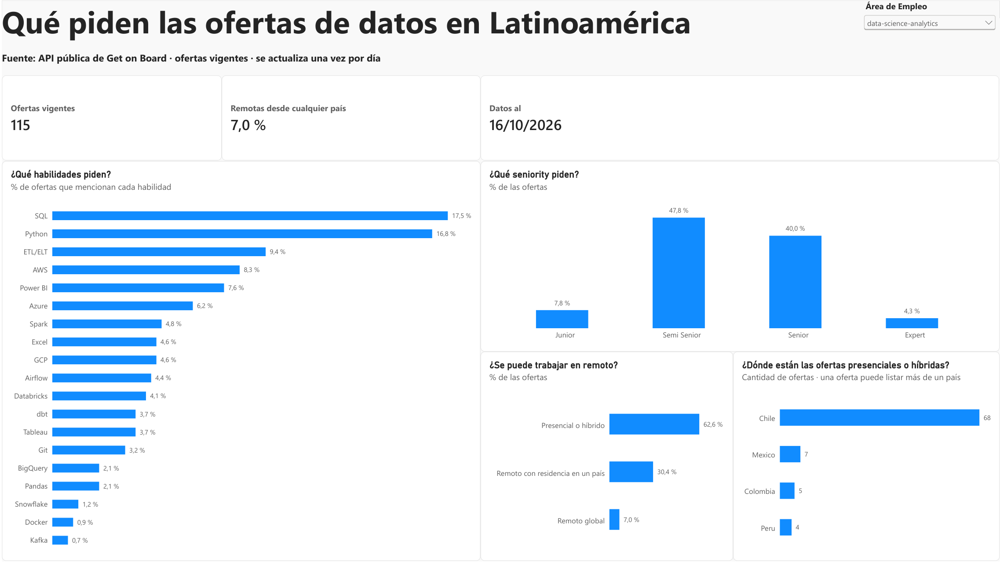
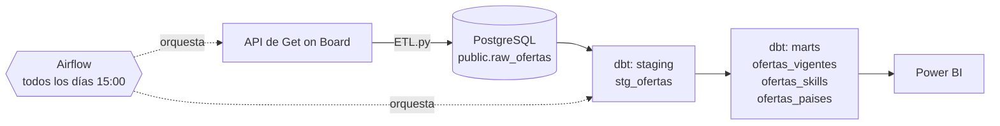

# Qué piden las ofertas de datos en Latinoamérica

Pipeline de datos de punta a punta que descarga todos los días las ofertas de trabajo de [Get on Board](https://www.getonbrd.com), las guarda en PostgreSQL, las transforma con dbt y las muestra en un tablero de Power BI. Todo orquestado con Airflow y corriendo en Docker.



## Qué responde

Pensado para alguien que busca trabajo en datos:

- ¿Qué **habilidades** piden las empresas?
- ¿Qué **seniority** buscan?
- ¿Se puede trabajar en **remoto**?
- ¿**Dónde** están las ofertas presenciales o híbridas?

### Algunos hallazgos (foto del 16/10/2026)

Área **data-science-analytics** (115 ofertas vigentes):

- **SQL (66 %) y Python (64 %)** aparecen en casi dos de cada tres ofertas. Le siguen ETL/ELT (36 %) y AWS (31 %).
- Casi 9 de cada 10 ofertas buscan perfiles **Semi Senior (48 %) o Senior (40 %)**. Junior: 8 %.
- Solo el **7 %** se puede hacer desde cualquier país. El 63 % es presencial o híbrido, y la mayoría de esas ofertas está en **Chile**.

Para comparar, en el área **programming** (319 ofertas) lo más pedido es AWS (36 %), Git (32 %) y SQL (31 %), y el remoto global sube al **23 %**.

## Arquitectura



Todos los servicios (PostgreSQL, Airflow y su base interna) corren en contenedores definidos en `docker-compose.yml`.

## Stack

| Capa | Herramienta |
|---|---|
| Extracción | Python (`requests`, `psycopg2`) |
| Almacenamiento | PostgreSQL 18 |
| Transformación | dbt Core 1.12 (dbt-postgres) |
| Orquestación | Apache Airflow 3.3 (LocalExecutor) |
| Infraestructura | Docker / Docker Compose |
| Visualización | Power BI Desktop (DAX) |

## Modelo de datos

El ETL guarda una **foto diaria** de cada oferta (clave `job_id` + `fecha_descarga`), en formato JSON crudo. dbt arma las tablas de análisis en el esquema `analytics`:

| Modelo | Grano | Para qué |
|---|---|---|
| `stg_ofertas` (vista) | 1 fila por oferta y día | Columnas tipadas a partir del JSON |
| `ofertas_vigentes` | 1 fila por oferta | Solo la última descarga de cada categoría. Agrega alcance remoto, seniority y tipo de contrato |
| `ofertas_skills` | oferta × habilidad | Habilidades detectadas con expresiones regulares en el texto de la oferta, agrupadas por perfil |
| `ofertas_paises` | oferta × país | Países de las ofertas presenciales o híbridas |

La calidad se controla con **16 tests de dbt** (unicidad, nulos, valores aceptados e integridad referencial), que corren en cada ejecución. Además, cada gráfico del tablero se validó contra una consulta SQL.

## Estructura del repositorio

```
├── ETL.py                      # Extracción desde la API y carga en PostgreSQL
├── docker-compose.yml          # PostgreSQL + Airflow
├── Dockerfile                  # Imagen de Airflow con dbt en un entorno aislado
├── .env.example                # Variables de entorno necesarias (copiar a .env)
├── airflow/
│   ├── dags/ofertas_diarias.py # DAG: descargas → dbt build
│   └── dbt_profiles/           # Conexión de dbt dentro del contenedor
├── dbt_ofertas/                # Proyecto dbt (seeds, staging, marts, tests)
├── sql/                        # Creación de tablas e informes SQL
├── power_bi/                   # Tablero (.pbix), tema de colores y consultas de validación
└── docs/                       # Documentación de cada fase
```

## Cómo correrlo

**Requisitos:** Docker Desktop. Para el tablero, Power BI Desktop (Windows).

1. Clonar el repo y crear el archivo de variables:
   ```bash
   git clone https://github.com/NeoG14/<nombre-del-repo>.git
   cd <nombre-del-repo>
   cp .env.example .env    # completar DB_PASSWORD
   ```
2. Levantar todo:
   ```bash
   docker compose up -d
   ```
   La primera vez construye la imagen de Airflow y crea las tablas en PostgreSQL.
3. Entrar a Airflow en `http://localhost:8080` (usuario y contraseña: `airflow`) y activar el DAG `ofertas_diarias`. Corre solo todos los días a las 15:00 (hora de Argentina), o se puede disparar a mano.
4. Abrir `power_bi/Ofertas.pbix` y tocar **Inicio → Actualizar**. La base se conecta en `localhost:5433`.

> No usar `docker compose down -v`: la opción `-v` borra los volúmenes con todo el histórico descargado, que no se puede volver a obtener.

## Decisiones destacadas

- **Fotos diarias en vez de sobrescribir:** guardar una copia por día permite, más adelante, analizar cómo cambia el mercado en el tiempo.
- **Datos crudos en JSON:** si la API agrega campos, no se pierden, y los modelos de dbt pueden empezar a usarlos sin volver a descargar nada.
- **dbt en un entorno virtual separado dentro de la imagen de Airflow**, para evitar conflictos de dependencias.
- **Relación bidireccional en Power BI** entre ofertas y habilidades, para poder filtrar todo el tablero por una habilidad. Requiere controlar con cuidado el contexto de filtro en DAX (detallado en [fase 5](docs/fase_5_visualizacion.md)).
- **Se descartó el gráfico de salarios:** solo el 37 % de las ofertas lo informa y la API no indica la moneda.

## Limitaciones

- Las habilidades se detectan por texto: una habilidad "deseable" cuenta igual que una obligatoria.
- Con ~100 ofertas por área, las habilidades poco frecuentes varían bastante de un día a otro.
- El tablero usa modo Import: hay que actualizarlo a mano para ver los datos del día.

## Próximos pasos

- Página de búsqueda de ofertas en el tablero (filtrar por habilidad, seniority y alcance, con link a cada oferta).
- Tendencias en el tiempo, a medida que se acumulan fotos diarias.
- Sumar otras fuentes de ofertas.
- Una página web para mostrar los datos.

## Documentación

| Fase | Documento |
|---|---|
| 1. Extracción | [docs/fase_1_extraccion.md](docs/fase_1_extraccion.md) |
| 2. Transformación con SQL | [docs/fase_2_transformacion.md](docs/fase_2_transformacion.md) |
| 3. Automatización (Docker + Airflow) | [docs/fase_3_automatizacion.md](docs/fase_3_automatizacion.md) |
| 4. Modelado con dbt | [docs/fase_4_dbt.md](docs/fase_4_dbt.md) |
| 5. Visualización (Power BI) | [docs/fase_5_visualizacion.md](docs/fase_5_visualizacion.md) |

## Autor

**Nicolás Alvarez de Oliveira** · Analista Programador Universitario (UNLP), estudiante de Ciencia de Datos para Organizaciones (UNLP).

[GitHub](https://github.com/NeoG14) · LinkedIn: _agregar link_

Datos: API pública de [Get on Board](https://www.getonbrd.com).
